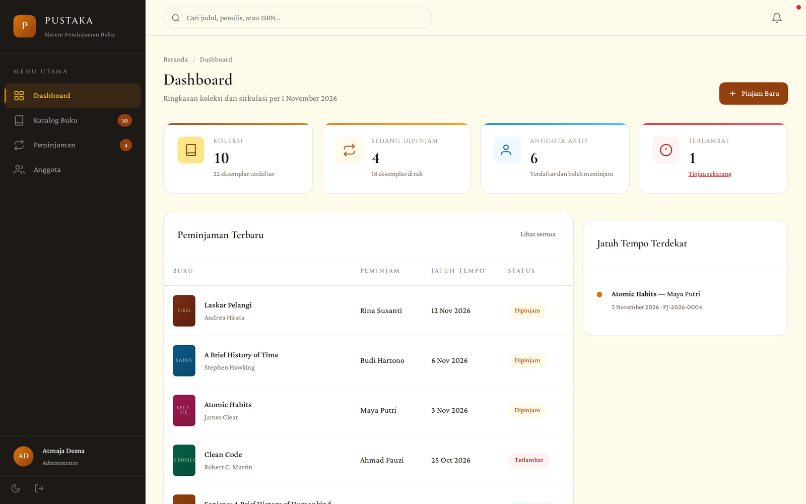
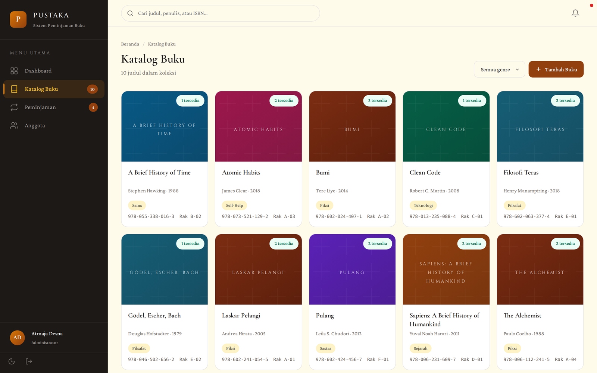
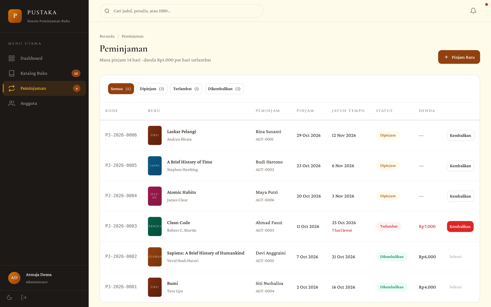
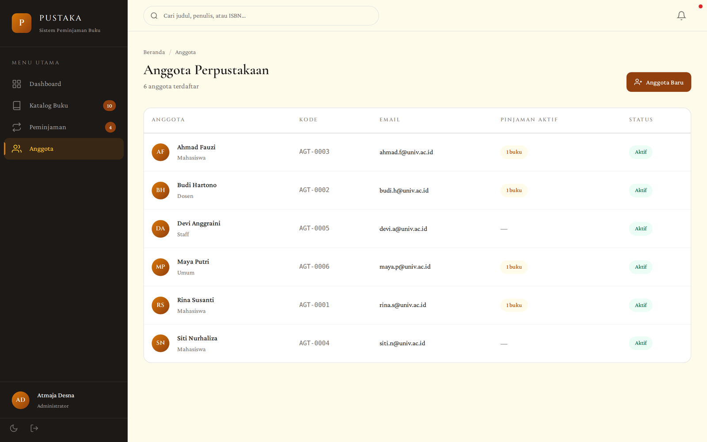
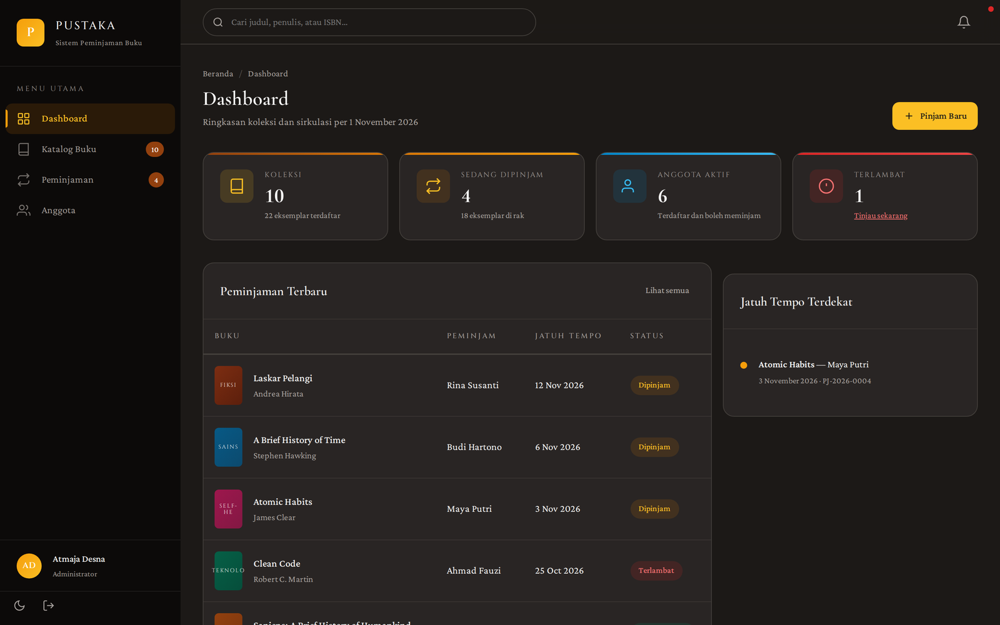

# Pustaka — Sistem Peminjaman Buku

Aplikasi web untuk mengelola sirkulasi perpustakaan: katalog koleksi, pencatatan peminjaman, pengembalian, denda keterlambatan, dan data anggota.

Dibangun dengan Laravel 13 + Blade + SQLite, tanpa framework CSS eksternal — seluruh antarmuka ditulis dengan CSS dan design token sendiri.

> **Status: prototipe lokal.** Belum pernah dipasang di server produksi dan tidak terhubung ke data perpustakaan mana pun. Seluruh isi basis data berasal dari seeder.



---

## Daftar isi

- [Fitur](#fitur)
- [Tampilan](#tampilan)
- [Menjalankan secara lokal](#menjalankan-secara-lokal)
- [Akun demo](#akun-demo)
- [Keputusan teknis](#keputusan-teknis)
- [Struktur basis data](#struktur-basis-data)
- [Pengujian](#pengujian)
- [Batasan](#batasan)
- [Lisensi](#lisensi)

---

## Fitur

**Katalog buku**
- Daftar koleksi dalam tampilan kartu, lengkap dengan genre, tahun terbit, ISBN, dan kode rak.
- Pencarian berdasarkan judul, penulis, atau ISBN.
- Filter per genre dan paginasi.
- Penambahan judul baru dengan validasi ISBN unik (pesan kesalahan dalam bahasa Indonesia).
- Ketersediaan dihitung otomatis: `stok − eksemplar yang sedang dipinjam`.

**Peminjaman**
- Pencatatan peminjaman baru dengan masa pinjam 14 hari.
- Empat tab filter — Semua, Dipinjam, Terlambat, Dikembalikan — yang saling lepas dan selalu berjumlah sama dengan total data.
- Penanda keterlambatan beserta jumlah hari dan denda berjalan.
- Proses pengembalian satu klik; denda dihitung saat pengembalian.

**Anggota**
- Daftar anggota dengan kode otomatis berurutan (`AGT-0001`, `AGT-0002`, …).
- Pencarian nama/email, status aktif, dan jumlah buku yang sedang dipegang.

**Antarmuka**
- Mode terang dan gelap, tersimpan di `localStorage` dan dihormati saat halaman dimuat.
- Navigasi responsif: sidebar tetap di layar lebar, laci geser di bawah 1024 px.
- Skip-link, penanda fokus, dan struktur landmark untuk pengguna keyboard serta pembaca layar.
- Seluruh teks memenuhi kontras minimum WCAG AA di kedua tema.
- Stylesheet khusus cetak yang menyembunyikan navigasi.

---

## Tampilan

| Katalog | Peminjaman |
|---|---|
|  |  |

| Anggota | Mode gelap |
|---|---|
|  |  |

---

## Menjalankan secara lokal

**Kebutuhan:** PHP 8.3+ dengan ekstensi `pdo_sqlite`, `mbstring`, `xml`, serta Composer.

```bash
git clone https://github.com/atmajadesna/peminjaman-buku.git
cd peminjaman-buku

composer install
cp .env.example .env
php artisan key:generate

touch database/database.sqlite
php artisan migrate --seed

php artisan serve
```

Buka <http://127.0.0.1:8000>. Halaman akar akan mengarahkan ke dashboard, dan ke halaman masuk bila belum ada sesi.

Untuk mengulang dari basis data kosong:

```bash
php artisan migrate:fresh --seed
```

---

## Akun demo

| Surel | Kata sandi |
|---|---|
| `petugas@perpus.test` | `password` |

Akun ini hanya ada di seeder dan hanya untuk menjalankan prototipe di mesin lokal. Jangan dipakai di lingkungan yang dapat diakses publik.

---

## Keputusan teknis

**Ketersediaan tidak disimpan sebagai kolom.** Tabel `books` hanya menyimpan `stock`. Jumlah eksemplar yang tersedia dihitung dari `stock` dikurangi peminjaman yang belum dikembalikan. Dengan begitu tidak ada penghitung yang bisa melenceng dari kenyataan, karena hanya ada satu sumber kebenaran.

**Peminjaman dibungkus transaksi dan penguncian baris.** `LendingService::borrow()` menjalankan `DB::transaction()` dan `lockForUpdate()` pada baris buku sebelum memeriksa sisa stok. Dua petugas yang menekan "Pinjam" pada detik yang sama tidak akan bisa meminjamkan eksemplar terakhir dua kali.

**Denda disimpan sebagai bilangan bulat rupiah.** Tidak ada `float` untuk uang. `Loan::FINE_PER_DAY = 1000` dan `LOAN_DAYS = 14` adalah konstanta pada model, sehingga aturan sirkulasi terbaca di satu tempat.

**Batas waktu dihitung per hari kalender, bukan per 24 jam.** Buku yang jatuh tempo hari ini belum dianggap terlambat — anggota masih punya sisa hari itu. Perbandingan dilakukan lewat `startOfDay()`.

**Tab filter membentuk partisi, bukan tumpang tindih.** `Dipinjam` berarti belum dikembalikan *dan* belum lewat jatuh tempo; `Terlambat` berarti belum dikembalikan *dan* sudah lewat. Karena itu `Dipinjam + Terlambat + Dikembalikan` selalu sama dengan total, dan ada test yang menjaga sifat ini.

**Warna sampul ditentukan genre, bukan acak.** Satu genre selalu memakai gradasi yang sama, sehingga katalog terbaca sebagai sistem dan bukan sebagai variasi yang sembarangan. Seluruh gradasi dipilih agar teks putih di atasnya tetap lolos kontras 4,5:1.

**Tanpa framework CSS.** Token warna, tipografi, dan jarak didefinisikan sebagai custom property di satu berkas (`public/css/pustaka.css`). Tidak ada proses build untuk aset, jadi aplikasi bisa dijalankan hanya dengan `php artisan serve`.

---

## Struktur basis data

```
books      id, title, author, isbn (unik), genre, published_year,
           stock, shelf_code, timestamps
           indeks: genre, title

members    id, code (unik), name, email (unik), phone,
           role, is_active, timestamps

loans      id, code (unik), book_id, member_id,
           borrowed_at, due_at, returned_at (nullable), fine, timestamps
           foreign key restrictOnDelete
           indeks: (book_id, returned_at), (member_id, returned_at), due_at
```

Kode peminjaman (`PJ-2026-0001`) dan kode anggota (`AGT-0001`) dibuat berurutan di dalam transaksi yang sama dengan penyimpanannya.

---

## Pengujian

```bash
php artisan test
```

29 test, 111 asersi. Mencakup alur peminjaman dan pengembalian, perhitungan denda per hari kalender, penolakan stok habis, penolakan anggota nonaktif, larangan meminjam judul yang sama dua kali, validasi ISBN ganda, pembuatan kode berurutan, serta sifat partisi pada tab filter.

Pemeriksaan antarmuka dijalankan terpisah dengan Playwright pada lima lebar layar (320, 375, 414, 768, 1024, 1440 px): alur masuk, katalog, modal, mode gelap, skip-link, laci navigasi, ketiadaan overflow horizontal, keselarasan kartu, dan tidak adanya galat JavaScript.

Untuk pemasangan yang bisa diakses publik, setel `PUSTAKA_DEMO=true`. Setiap halaman akan menampilkan pemberitahuan bahwa data di dalamnya buatan dan dapat diubah siapa saja.

---

## Batasan

Ditulis apa adanya, supaya tidak ada yang mengira aplikasi ini lebih matang dari kenyataannya:

- **Satu peran pengguna.** Semua yang masuk adalah petugas. Belum ada pemisahan hak akses antara admin, pustakawan, dan anggota.
- **Belum ada akun anggota.** Anggota adalah data yang dikelola petugas; mereka tidak bisa masuk sendiri, memesan buku, atau memperpanjang pinjaman.
- **Denda hanya dicatat, belum dibayar.** Tidak ada pencatatan pembayaran, pembebasan denda, atau riwayat transaksi keuangan.
- **Tanpa pencarian kode batang.** ISBN diketik manual.
- **Tanpa notifikasi.** Tidak ada surel atau pengingat jatuh tempo; panel "jatuh tempo terdekat" hanya membaca data saat halaman dibuka.
- **Belum ada impor/ekspor.** Data tidak bisa diunggah dari Excel atau diekspor ke CSV.
- **Belum diuji beban.** SQLite cukup untuk prototipe dan demo, bukan untuk banyak petugas yang menulis bersamaan.
- **Belum dipasang di mana pun.** Repositori ini berisi kode, bukan layanan yang sedang berjalan.

---

## Lisensi

MIT — lihat [LICENSE](LICENSE).

Dibuat oleh [Atmaja Desna Adinata](https://github.com/atmajadesna).
